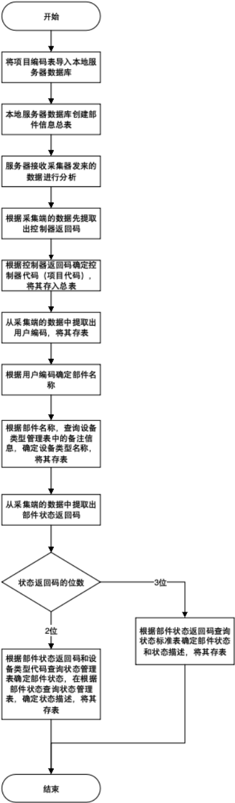
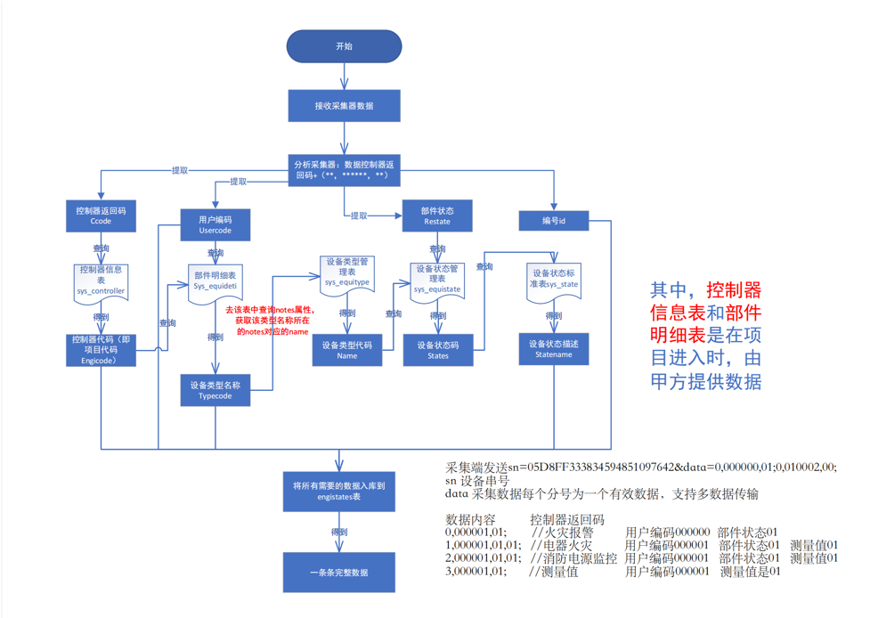
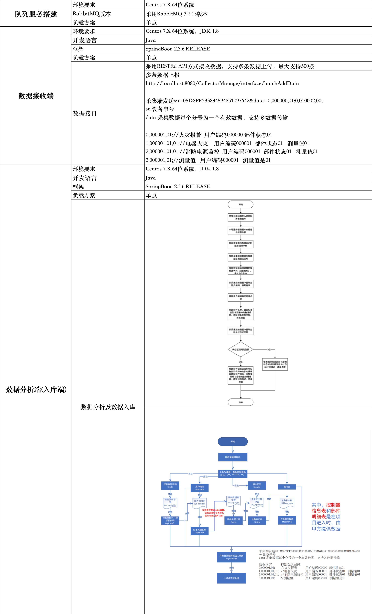

# 山东省消防平台消息队列实施项目

`为了进一步做好消防维保、监督工作，建立长效的消防监督机制，确保消防设备安全运行，潍坊平安消防公司根据省消防机构的要求，整理消防机构、维保机构、消防单位的具体需求，建设山东省消防维保监督平台,实现山东省消防动态监控和静态监管、维保服务的信息化，为此建设山东省消防维保监督平台，为领导层提供管理工具，为维保人员提供服务工具，为消防单位提供惠民服务。`

## 部分业务逻辑

## 项目技术参数

## 接口文档使用说明

[文档地址](https://m67r3yr787.feishu.cn/docx/LD6BdYzbLoe6jaxnkPJczukNnhc?from=from_copylink)
